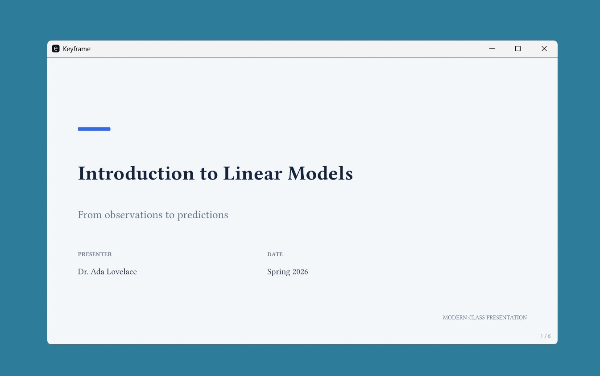

# Keyframe

A native, cross-platform desktop app for presenting PDF slides. Open Keyframe
from your application launcher, choose a PDF, and click **Present**.

## Desktop workflow

- **Open PDF…** opens the operating system's file picker. You can also drag a
  PDF into the window or use `Ctrl+O` (`Cmd+O` on macOS).
- The welcome screen and **File → Open recent** list your last eight decks.
- The bottom toolbar offers previous/next, first/last, and an editable slide number.
- **Present** switches to fullscreen and hides the toolbars. `Esc` returns to
  the desktop window; it also dismisses Settings and Shortcuts.
- **Settings** adjusts render resolution, prefetching, background color,
  slide-cache memory, startup fullscreen, and vsync. Preferences and recent
  documents persist.
- File and rendering errors appear in the window, with a way to open another
  PDF. An unsuccessful file open keeps the current presentation available.

## Speaker notes and pdfpc

Click **Speaker notes** to open a separate native presenter window. **Present**
also opens it, while the original window becomes the audience display. Move
the audience window to your projector before presenting. The presenter shows
the current slide, next slide, and an editable note for the current page.
Navigation in either window updates both windows; typing in the note editor
does not trigger slide shortcuts.

Keyframe automatically reads `deck.pdfpc` beside `deck.pdf`. It reads pdfpc
JSON formats 1 and 2, including label/overlay mapping, and legacy `[notes]`
files. It saves edits as format 2, preserving existing page flags, timing,
Markdown settings, and other metadata. Legacy files get a backup before
conversion. Notes also load from PDF text annotations when a sidecar note
does not override them. Markdown text is preserved and edited as source.

Edits save after a short pause, with **Save notes** or `Ctrl/Cmd+S` available
in the presenter window. Changes are saved before switching or closing a
document. If saving fails, edits remain in memory and the app keeps the
document open. If another program changes the sidecar, Keyframe reports the
conflict instead of overwriting it; copy your edits before reopening the PDF.

For Beamer PDFs with notes on half of each page, select **Beamer notes: right,
left, top, or bottom** in the presenter. The audience sees only the slide
half, while the note half appears in the presenter. This selection is stored
in pdfpc's `beamerNotePosition` field.

Compatibility covers speaker notes and split-page layouts; pdfpc's videos,
transitions, timers, hidden-slide navigation, and remote-control interfaces
are not implemented. Their existing sidecar metadata is preserved.

The desktop uses the OpenGL renderer to reduce fixed graphics-backend overhead.
The PDF is opened once on its render thread for both metadata and rasterization.
Rendering completion wakes the UI, so it does not poll the worker every 8 ms.

The renderer replaces obsolete requests instead of accumulating them, bounds
completed results to two pages, releases CPU images after GPU upload, and
evicts textures outside the current prefetch window and its 24 MiB budget.
The current slide keeps its full render quality even when it exceeds that
budget; neighboring pages are prefetched only when they fit. A preview that
does not fit shows a message instead of an indefinite spinner. This budget
limits page textures, rather than the entire process or MuPDF's internal cache.
Closing or replacing a document stops and joins its worker. Prefetch is capped
at five pages on each
side, and individual rasters are capped at 16 megapixels and 4096 pixels per
side to keep unusually large PDFs from allocating unbounded page buffers.

## Desktop installation

Release builds include a Windows per-user installer (Start menu shortcut,
desktop shortcut, and PDF **Open with** entry), macOS `.pkg` installers and
`.app` ZIPs for Apple Silicon and Intel, and Linux AppImages for x64 and ARM64,
alongside desktop archives and portable executables.

On Windows, run `keyframe-windows-x64-setup.exe`. It installs for your Windows
account without administrator access and includes the C++ runtime DLLs. Open
**Keyframe** from the Start menu or its desktop shortcut. You do not need Rust
or a terminal. Right-click a PDF and choose **Open with → Keyframe** to open a
deck directly; installation keeps your existing default PDF app. Uninstall
through Windows **Settings → Apps → Installed apps**. Your preferences and
speaker-note files are preserved.

The portable executable can also be launched directly, provided the Microsoft
Visual C++ runtime is installed. Neither version opens a console window.

On macOS, choose `keyframe-macos-arm64.pkg` for Apple Silicon or
`keyframe-macos-x64.pkg` for Intel. Open the installer to install **Keyframe**
in Applications, then launch it from Finder or Spotlight. The corresponding
`-app.zip` is also available if you prefer to move the app into Applications
yourself. The app is ad-hoc signed; the installer is unsigned and neither is
notarized. macOS may block the initial launch or installation until you
approve it in **System Settings → Privacy & Security**.

On Linux, download `keyframe-linux-x64.AppImage` or
`keyframe-linux-arm64.AppImage`, enable **Allow executing file as program**
in its file properties, and double-click it. AppImages require FUSE; on a
system without it, run the AppImage with `--appimage-extract-and-run`.
The x64 build targets Ubuntu 22.04 or newer; ARM64 targets Ubuntu 24.04 or
newer (or distributions with compatible glibc versions). Graphics drivers
and a desktop session must be available on the host.

For a traditional Linux installation, extract the `-desktop.tar.gz` archive
and install its `bin/` and `share/` contents into `~/.local/` (ensure
`~/.local/bin` is in `PATH`). The Nix package installs the launcher and icon
automatically. The native file picker uses the desktop's
`xdg-desktop-portal` service.



## Build prerequisites

`mupdf-sys` compiles MuPDF from source at build time (there's no
lightweight "just bind to a system lib" option unless you enable the
`sys-lib` Cargo feature and have MuPDF already installed). You'll need:

- A C/C++ compiler toolchain
  - Linux: `build-essential` (gcc/g++, make) or clang
  - macOS: Xcode Command Line Tools (`xcode-select --install`)
  - Windows: MSVC Build Tools (Visual Studio "Desktop development with
    C++" workload)
- `cmake`
- `python3` (used by MuPDF's build scripts)
- A recent Rust stable toolchain

## Build & run

```sh
cargo run --release
```

After building, launch `target/release/keyframe` (Windows:
`target\release\keyframe.exe`) directly. A PDF path remains an optional
command-line argument for file associations and scripts.

To build the Windows installer, install Inno Setup 6 and the Visual Studio
C++ build tools, then run:

```powershell
./scripts/package-windows.ps1
```

The script builds the release executable, finds the Visual Studio x64 C++
runtime redistributable DLLs, and produces
`dist/keyframe-windows-x64-setup.exe`. Use `-SkipBuild` to package an existing
release build, `-IsccPath` to specify the Inno Setup compiler, or
`-RuntimeDirectory` to specify the redistributable DLL folder. Run
`./scripts/generate-windows-icons.ps1` after changing the app icon artwork.
On macOS, use `bash scripts/package-macos.sh PATH_TO_RELEASE_BINARY arm64`
(or `x64`). On Linux, use
`bash scripts/package-linux.sh PATH_TO_RELEASE_BINARY x64` (or `arm64`);
the script downloads linuxdeploy and bundles shared libraries, including
the window-system libraries loaded at runtime. Build on the matching OS
and architecture. The workflow lists the required Linux build packages.

The **Release** GitHub Actions workflow builds and tests all five platform
targets. Run it manually from the Actions tab to download installers from
the workflow artifacts. Pushing a `v*` tag additionally publishes all packages
and SHA-256 checksum manifests to a GitHub Release. Manual runs do not create
a release. Linux CI launches each AppImage under a virtual display; macOS
packaging validates the app signature and installer payload.

## Controls

These are the default keybinds. They are all configurable in the configuration file

| Action              | Default keys                              |
|---------------------|--------------------------------------------|
| Next slide          | `→` `↓` `Space` `PageDown` `j` `l` `n`      |
| Previous slide       | `←` `↑` `Backspace` `PageUp` `k` `h` `p`    |
| First slide          | `Home` `g`                                  |
| Last slide           | `End` `Shift+G`                             |
| Toggle fullscreen    | `f` `F11`                                   |
| Open PDF             | `Ctrl+O` / `Cmd+O`                         |
| Keyboard shortcuts   | `F1` `?`                                   |
| Leave fullscreen / dismiss dialog | `Esc`                         |
| Quit                 | `q` or **File → Quit**                     |

## Configuration

- Linux: `~/.config/keyframe/config.toml`
- macOS: `~/Library/Application Support/dev.keyframe.keyframe/config.toml`
- Windows: `%APPDATA%\keyframe\keyframe\config\config.toml`

```toml
# Pages to prefetch/cache on each side of the current page.
# 1 = current + immediate previous/next (the default).
cache_window = 1

# Budget for RGBA slide textures, in MiB (4-128). The current slide is kept
# even if it exceeds this limit. Reduce prefetching before reducing DPI.
cache_memory_mb = 24

# Rendering resolution in DPI. Higher = crisper on big/high-DPI
# displays, slower to render, more memory per cached page.
render_dpi = 150.0

# Background/letterbox color, [r, g, b] 0-255.
background_color = [18, 18, 18]

start_fullscreen = false
vsync = true

# Optional keybind overrides, leave out an action to keep its defaults.
[keybinds]
next_page = ["Right", "Space", "j", "l"]
prev_page = ["Left", "Backspace", "k", "h"]
```
